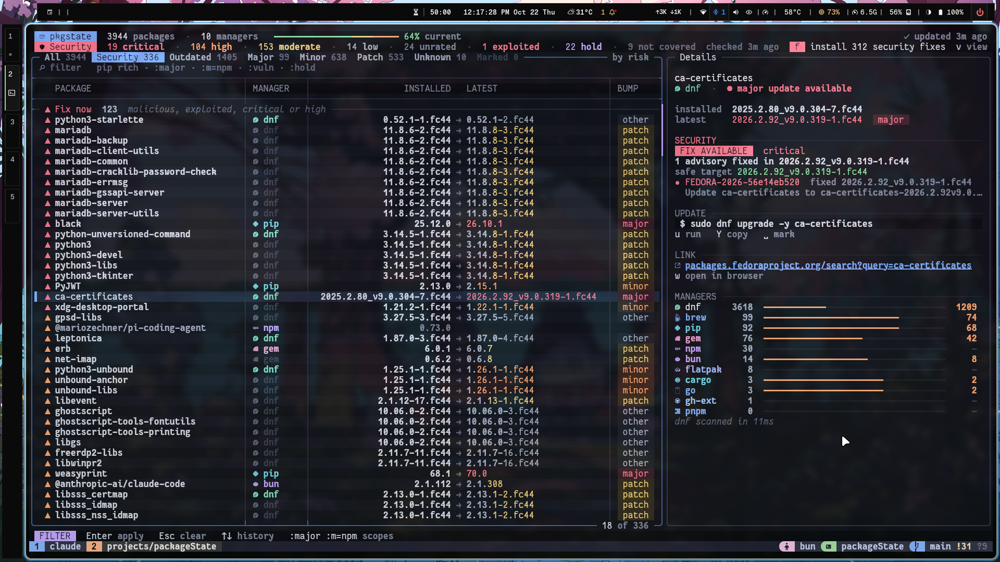

# kavach

A laptop-wide package state manager. One TUI that shows every package installed across every package manager on your system, which are outdated, and lets you update them on demand.



## Supported package managers

Auto-detected; any that aren't installed are skipped silently.

- `dnf` (Fedora/RHEL system packages)
- `flatpak`
- `snap`
- `brew` (Homebrew / Linuxbrew)
- `pip` (user site)
- `pipx`
- `npm` (global)
- `pnpm` (global)
- `bun` (global)
- `cargo` (installed binaries — latest checked via crates.io)
- `gem`
- `go` (binaries in `$GOBIN` / `$GOPATH/bin` — latest checked via proxy.golang.org)
- `vscode` (VS Code extensions)
- `gh-ext` (GitHub CLI extensions)

## Install

```sh
bun install
bun run src/cli.ts              # launch the TUI
bun run src/cli.ts scan         # human summary + outdated table
bun run src/cli.ts scan --json  # machine-readable output
bun run build                   # compile ./dist/kavach
```

For local shell use, run `bun link` from this repo and then call `kavach`.

## TUI keys

| Key | Action |
|-----|--------|
| `/` | Focus the filter (fuzzy + `:`-scopes) |
| `j` / `k` (or arrows) | Move selection |
| `s` | Cycle sort column (status, manager, name, installed, latest) |
| `S` | Reverse sort |
| `o` | Toggle outdated-only filter |
| `m` | Toggle manager grouping |
| `y` / `Y` | Copy selected package id / update command |
| `u` | Update highlighted package (confirms first) |
| `U` | Update every visible outdated package |
| `r` | Rescan everything (bypass cache) |
| `q` | Quit |

Filter examples: `rich` · `pip rich` · `:outdated` · `:m=npm :outdated` · `:m=pip rich` · `:s=unknown`. See [docs/filter-language.md](docs/filter-language.md).

Updates run the underlying package manager command as argv (no shell), for example `sudo dnf upgrade <pkg>` or `brew upgrade <pkg>`. You'll be prompted before anything is executed; sudo prompts surface in the same terminal.

## CLI examples

```sh
bun run src/cli.ts scan --no-check-updates
bun run src/cli.ts scan --manager npm,pnpm --outdated
bun run src/cli.ts scan --json --filter ':m=pip :outdated'
bun run src/cli.ts cache show
bun run src/cli.ts daemon --once
bun run src/cli.ts web --port 4321
bun run src/cli.ts vulns
bun run src/cli.ts vulns --manager pip --verbose
bun run src/cli.ts diff
```

## Cache

Latest-version lookups are cached at `~/.cache/kavach/cache.json` with **stale-while-revalidate**: registry lookups are fresh for 1 h and usable stale for 7 days; whole-adapter scan results are fresh for 15 min and usable stale for 2 h. Press `r` in the TUI or run `kavach scan --refresh` to force a refresh. See [docs/caching.md](docs/caching.md).

## Docs

Long-form documentation lives in [`docs/`](docs/README.md): architecture, adapters, TUI, CLI, security checks, caching, filter language, adding adapters, troubleshooting.
