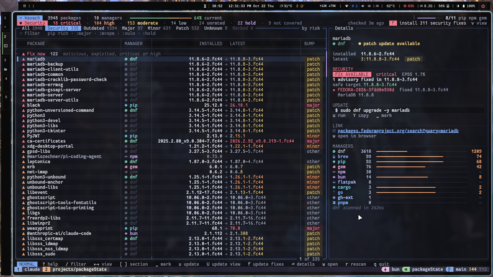
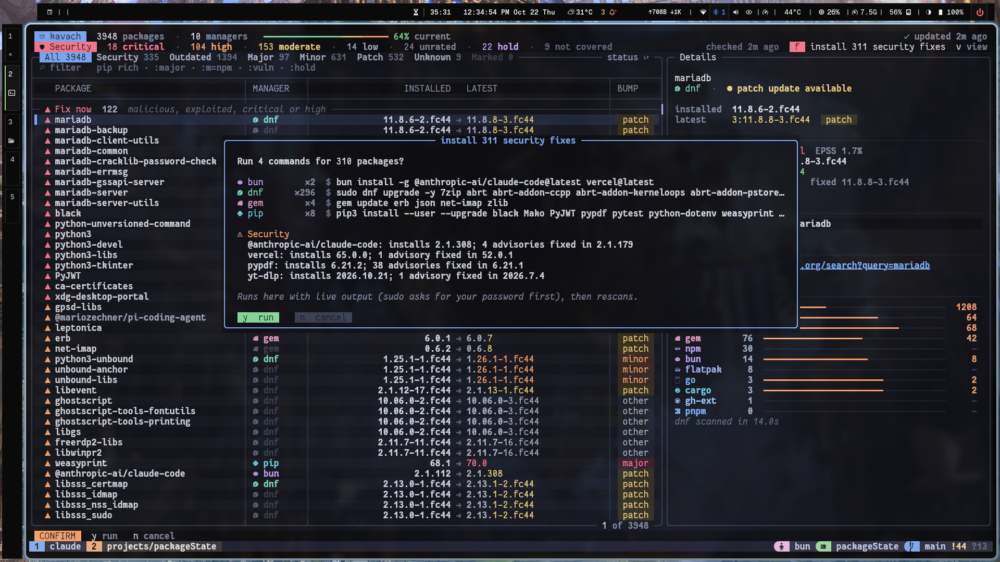
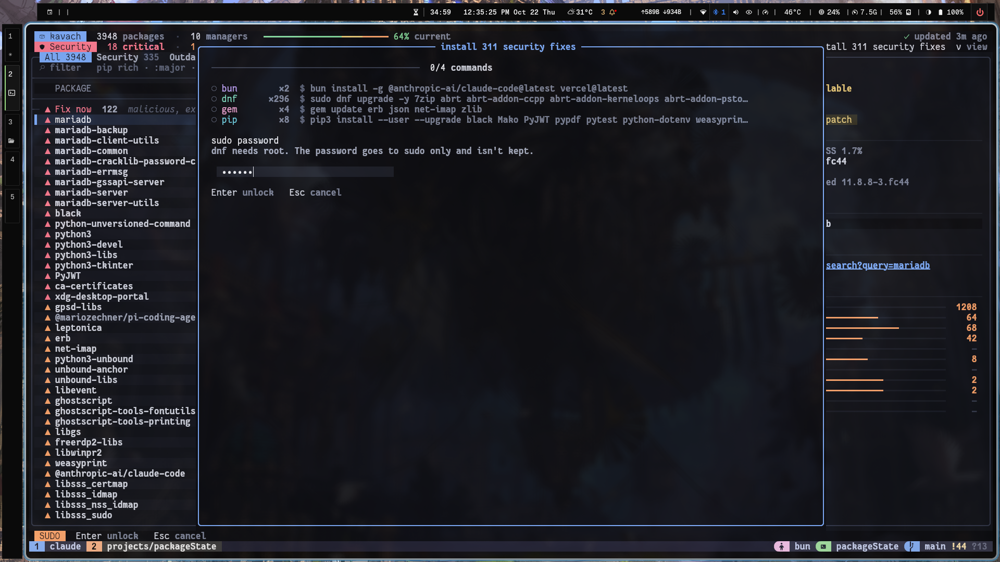
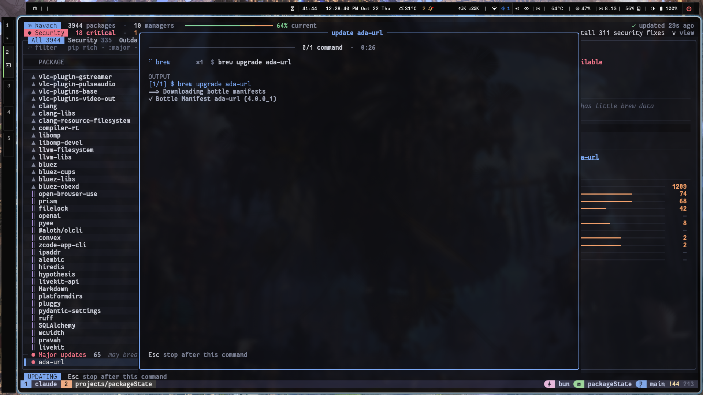

# kavach

Every package on your laptop in one terminal view: what's outdated, what's vulnerable, and which updates are safe to take. Updates run inside the TUI, sudo prompt and live output included.



## Why

A dev laptop collects packages from dnf, pip, npm, brew, cargo, gem and more. Each package manager only knows its own packages, and none of them tells you which updates fix a known vulnerability. kavach scans them all and checks every installed version against public advisory data. Whatever needs fixing goes first.

## Quick start

Needs [Bun](https://bun.sh) 1.3+ on Linux or macOS.

```sh
git clone https://github.com/Snehit70/kavach && cd kavach
bun install
bun run src/cli.ts          # open the TUI
```

Run `bun link` to get a `kavach` command, or `bun run build` for a single binary at `dist/kavach`.

## What it shows

**Security comes first.** The table opens on **Fix now**: packages that are malicious, exploited, critical or high severity and have a fix. Press `f` to install them all. Every package gets one verdict:

| Verdict | Meaning |
|---------|---------|
| Fix | The installed version has advisories and a fixed release exists. kavach picks a safe target, which isn't always the latest. |
| No fix | Advisories apply and updating won't help yet. |
| Hold | What you have is fine, but don't take the latest yet: it has its own advisories or is less than 7 days old, and most poisoned releases are caught within days. |
| Malware | The installed release is a known malicious package. |

Two signals mark the most urgent ones:

- **Exploited**: the CVE is in [CISA's Known Exploited Vulnerabilities](https://www.cisa.gov/known-exploited-vulnerabilities-catalog) catalog, so attackers are using it in real attacks. That doesn't mean your machine was attacked, but these are the ones to patch first.
- **EPSS**: [FIRST's](https://www.first.org/epss/) estimate of how likely a CVE is to be exploited in the next 30 days.

The data comes from [OSV.dev](https://osv.dev), Fedora's dnf security advisories, CISA KEV and FIRST EPSS. It's cached, so after the first scan the next ones are fast. Details: [docs/security.md](docs/security.md).

**Updates run in the TUI.** You see the exact commands before anything runs:



If a command needs root, the panel asks for your sudo password. It goes to `sudo -v` only and never reaches the package managers:



Then each command runs with its output streamed live. `Esc` stops after the current command, and `k` pressed twice kills one that's stuck. Closing the panel rescans:



## Supported package managers

kavach finds these on its own and skips any you don't have.

`dnf` · `flatpak` · `snap` · `brew` · `pip` (user) · `pipx` · `npm` (global) · `pnpm` (global) · `bun` (global) · `cargo` · `gem` · `go` binaries · VS Code extensions · `gh` extensions

To add your own, see [docs/adding-an-adapter.md](docs/adding-an-adapter.md).

## Keys

| Key | Action |
|-----|--------|
| `j` `k` / arrows | Move |
| `[` `]` | Previous / next section |
| `←` `→` / `Tab` | Switch view: All, Security, Outdated, Major, Minor, Patch |
| `/` | Filter, e.g. `rich`, `pip rich`, `:major`, `:m=npm`, `:vuln`, `:hold` |
| `space` | Mark a package |
| `u` / `U` | Update the selected package / the marked ones (or the whole view) |
| `f` | Install every security fix |
| `Enter` | Details panel |
| `w` | Open the package page |
| `Y` | Copy the update command |
| `r` / `V` | Rescan / re-check vulnerabilities |
| `t` | Next theme |
| `?` | All keys |
| `q` | Quit |

## CLI

```sh
kavach scan                        # summary and outdated table
kavach scan --json --filter ':m=pip :outdated'
kavach vulns                       # security report, riskiest first
kavach vulns requests@2.19.0       # check one package, installed or not
kavach vulns --json --exit-code    # exits 1 if anything is affected (cron, CI)
kavach diff                        # diff the last two scan snapshots
kavach daemon --once               # desktop notification for new updates and critical issues
kavach web                         # web view on 127.0.0.1
```

Full reference: [docs/cli.md](docs/cli.md).

## Configuration

Optional, in `~/.config/kavach/config.toml`:

```toml
[security]
cooldown_days = 3   # hold releases younger than this; 0 turns it off (default 7)
```

[docs/caching.md](docs/caching.md) covers the cache, and [docs/troubleshooting.md](docs/troubleshooting.md) covers common problems.

## Development

```sh
bun run check     # typecheck, lint, tests
bun run build     # compile dist/kavach
```

Releases are cut from the changelog:

```sh
bun run release minor            # or patch, major, 1.2.0-rc.1
git commit -am "release: v0.2.0"
git tag -a v0.2.0 -m v0.2.0
git push --follow-tags           # CI builds the binaries and publishes the release
```

More docs: [architecture](docs/architecture.md) · [TUI](docs/tui.md) · [adapters](docs/adapters.md) · [filter language](docs/filter-language.md) · [index](docs/README.md)
